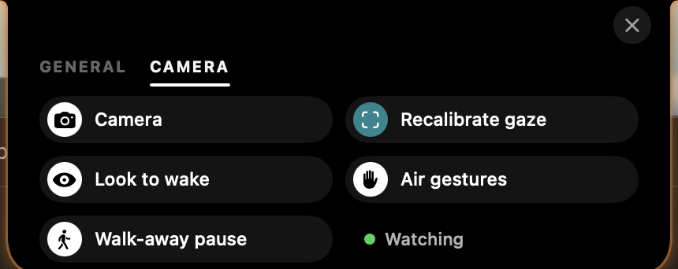
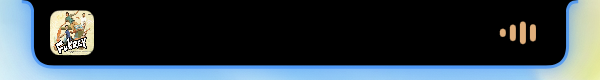
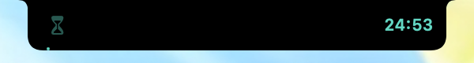
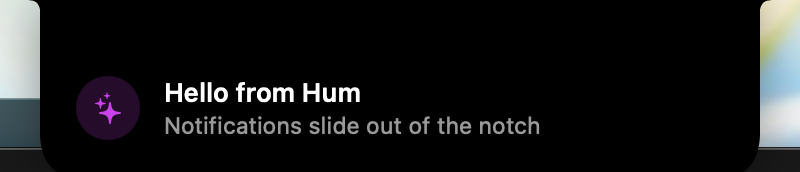
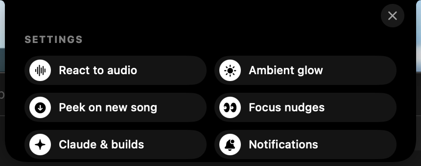

<p align="center">
  
</p>

<h1 align="center">Hum</h1>

<p align="center">
  <b>Your MacBook's notch has been doing nothing. Now it hums.</b><br>
  A tiny free app that turns the notch into a music player you can control with a wave of your hand.
</p>

<p align="center">
  <a href="https://github.com/ruturaj-ghatage/hum/releases/latest"><b>⬇️ Download</b></a> ·
  <a href="#-install-in-30-seconds">Install</a> ·
  <a href="#-wave-at-it">Air gestures</a> ·
  <a href="#-everything-else-it-does">Features</a>
</p>

<p align="center">
  
</p>

---

## ✨ What is this?

The black notch at the top of your MacBook screen is dead space. **Hum brings it to life:**

- 🎵 **See what's playing.** Album art and live sound bars sit right next to the notch.
- 🥁 **It moves to the beat.** The bars follow the actual song, and the notch pulses with every bass hit.
- 👋 **Control music in the air.** Show your palm to pause. Swipe your hand to skip. No keyboard, no mouse.
- 👀 **Look up to open it.** Glance at the notch and the player slides open.
- 🤖 **Know when Claude Code is done.** The notch glows while your AI is working and ripples green when it's done.

Works with **Spotify** and **Apple Music**. Free and open source.

<p align="center">
  
</p>

---

## 👋 Wave at it

Your MacBook's camera sits right in the notch, so Hum lets you control music with your hand.

| Do this | What happens |
|---|---|
| ✋ **Hold up an open palm** for about a second | Play / pause |
| 👉 **Raise your hand, wait a second, then swipe right** | Next song |
| 👈 **Raise your hand, wait a second, then swipe left** | Previous song |

**Tips that make it work every time:**

- 🪑 **Sit back a little.** Use it from a comfortable distance, about an arm's length from the screen. If you're too close, the camera can't see your whole hand and nothing happens.
- ⏱️ **For swipes, raise your hand first and wait a second, *then* swipe.** Hum ignores the motion of your hand coming into view, so a swipe that starts while you're still raising your hand won't count.
- ↔️ **Make the swipe big and quick,** from in front of you out to the side.
- ✋ **After a palm, lower your hand** before doing it again.

> 🔒 **Private by design.** The camera is **off until you turn it on.** Video is processed on your Mac, never saved, never uploaded. macOS shows its green camera light whenever it's on.

**Turn it on:** hover over the notch → click ⚙️ → **Camera** tab → switch on **Camera**.

<p align="center">
  
</p>

### 👀 Look up to open

Glance up at the notch and the player slides open. Look back down and it tucks away.

To set it up, click **Calibrate gaze** in the Camera tab, then follow the two prompts: look at the notch, then at the middle of your screen. It takes 6 seconds.

---

## 🚀 Install in 30 seconds

### Option A: Download (easiest)

1. Download **Hum.zip** from the [latest release](https://github.com/ruturaj-ghatage/hum/releases/latest).
2. Unzip it and drag **Hum** into your **Applications** folder.
3. Open it. macOS will say it can't verify the app (Hum is free and not signed by Apple yet). Go to **System Settings → Privacy & Security**, scroll down, and click **Open Anyway**.
4. Play a song on Spotify. Look at your notch. 🎉

<details>
<summary>Prefer the Terminal? Skip step 3 with one command</summary>

```bash
xattr -dr com.apple.quarantine /Applications/Hum.app
```
</details>

### Option B: Build it yourself

You need macOS 14 or later and Apple's free developer tools (`xcode-select --install`).

```bash
git clone https://github.com/ruturaj-ghatage/hum.git
cd hum
./build.sh install
open ~/Applications/Hum.app
```

**The first time you use each feature, macOS asks for permission once:**

| macOS asks | Why |
|---|---|
| Control **Spotify** / **Music** | Show the artwork and handle play, pause and skip |
| Record **system audio** | Make the bars move to the real music. Nothing is recorded or saved. |
| Use the **camera** (only if you turn it on) | Hand gestures and look to open |

---

## 🎛 Everything else it does

### 🎵 A music player in your notch
- **Hover** over the notch to open the full player: artwork, song, artist, a seek bar you can drag, and ⏮ ⏯ ⏭.
- **New song?** The cover "drips" in and the player peeks open for 3 seconds.
- **Physics:** pull the player down and it springs back. Fling it sideways to skip, or flick it up to close it.
- **Colors match the album,** including a soft glow around your screen edges that breathes with the bass.

### 🤖 Claude Code and build status

<p align="center">
  <br>
  
</p>

- 🟠 **Orange glow:** Claude is working, with a timer if no music is playing.
- 🔵 **Blue glow:** Claude needs your permission.
- 🟢 **Green ripple:** done, with a "Claude finished" notification for longer tasks.

To set it up, run this once:

```bash
./scripts/install-claude-hooks.sh
```

It keeps your existing settings and makes a backup first.

**Works for any command too.** Put `hum-run` in front of it:

```bash
hum-run npm test     # glows while running, then ✅ or ❌
```

<details>
<summary>How to install hum-run</summary>

```bash
ln -s ~/Applications/Hum.app/Contents/Resources/hum-run /usr/local/bin/hum-run
```
</details>

### ⏳ Focus mode

<p align="center">
  
</p>

Start a 25, 50 or 90 minute focus session from the menu bar icon. The notch counts down. If you open YouTube, X, Reddit or Discord, the notch **shakes at you** and tells you to get back to work. 😤

### 🔔 Notifications from the notch

<p align="center">
  
</p>

Any script can make a notification slide out of the notch:

```bash
open -g "hum://notify?title=Deploy%20done&body=api%20is%20live&symbol=checkmark.circle.fill&color=green"
```

### ⚙️ Turn anything on or off

Hover over the notch and click ⚙️. Every feature has its own switch.

<p align="center">
  
</p>

---

## 🛠 For the curious

<details>
<summary>How it works</summary>

- **Music:** Spotify and Music announce every play, pause and song change, so Hum just listens instead of checking constantly. AppleScript fetches the artwork and sends play/pause/skip.
- **Beat:** a Core Audio system tap feeds a frequency analysis (Accelerate) that splits the sound into bass, mids and highs.
- **Camera:** Apple's Vision framework runs on your Mac. It tracks face position and head angle for "look to open", and finger positions for gestures.
- **Claude Code:** Claude Code hooks send events to Hum through its `hum://` URL scheme.
- **The notch:** a borderless window above the menu bar, drawn with SwiftUI and sized to your exact notch.

| File | What it does |
|---|---|
| `Sources/Hum/NowPlaying.swift` | Spotify / Music state and controls |
| `Sources/Hum/NotchView.swift` | Everything you see in the notch |
| `Sources/Hum/NotchController.swift` | Window, hover, peeks, notifications |
| `Sources/Hum/AudioLevels.swift` | System audio and beat detection |
| `Sources/Hum/CameraSensor.swift` | Gestures and gaze |
| `Sources/Hum/FocusGuardian.swift` | Focus timer and distraction check |
| `Sources/Hum/ActivityTracker.swift` | Claude Code and `hum-run` status |

Run with `HUM_DEBUG=1` to print what the camera sees (hand and gaze values), which is handy for tuning.

Every push to `main` is built by GitHub Actions and released automatically.
</details>

## 🗺 Coming next

- [ ] Synced lyrics, karaoke-style under the notch
- [ ] Signed and notarized download (no "Open Anyway" step)
- [ ] `brew install --cask hum`

## ❤️ Like it?

Star the repo ⭐ so more people find it. Issues and pull requests are very welcome.

[MIT License](LICENSE)
