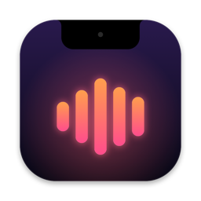
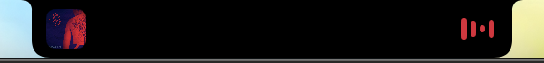
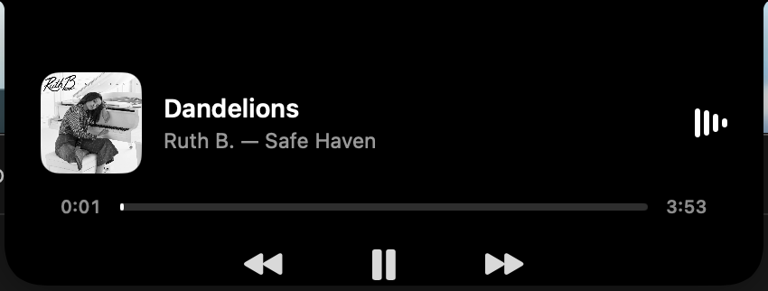

<p align="center">
  
</p>

<h1 align="center">Hum</h1>

<p align="center">Your MacBook's notch, now playing.</p>

Hum is a tiny menu bar app that turns the notch into a live music player for **Spotify** and **Apple Music**.

<p align="center">
  
</p>

<p align="center">
  
</p>

## Features

- **Compact mode:** while music plays, the notch grows just enough to show the album art on one side and live bars on the other.
- **Hover to expand:** shows the title, artist and album, a progress bar you can drag to seek, and previous / play-pause / next.
- **Peek:** when a new song starts, the player drops down for 3 seconds and tucks back in.
- **Adaptive color:** the bars and progress bar pick up the most vivid color in the album art.
- **Click the art** to open Spotify or Music.
- No Dock icon. Settings live in the menu bar, including **Launch at Login**.

## Install

### Build from source (recommended)

You need macOS 14 or later and Apple's command-line tools (`xcode-select --install`).

```bash
git clone https://github.com/ruturaj-ghatage/hum.git
cd hum
./build.sh install
open ~/Applications/Hum.app
```

### Download a release

Download `Hum.zip` from [Releases](https://github.com/ruturaj-ghatage/hum/releases), unzip it and move `Hum.app` to Applications.

Hum isn't notarized yet, so macOS blocks it the first time. Open **System Settings → Privacy & Security** and click **Open Anyway**, or run:

```bash
xattr -dr com.apple.quarantine /Applications/Hum.app
```

### First launch

macOS asks whether Hum can control Spotify (or Music). Click **OK**. Hum uses this to read the artwork and position and to send play/pause/skip.

## How it works

- Spotify and Music post a distributed notification (`com.spotify.client.PlaybackStateChanged`, `com.apple.Music.playerInfo`) on every play, pause or track change, so Hum doesn't poll.
- AppleScript fetches the artwork and position and sends playback controls. Hum only talks to a player that is already running, so it never launches one.
- The notch is a borderless `NSPanel` above the menu bar, drawn with SwiftUI. Its size comes from `NSScreen.safeAreaInsets` and `auxiliaryTopLeftArea`/`auxiliaryTopRightArea`. On a display without a notch, Hum draws a matching one.

| File | What it does |
|---|---|
| `Sources/Hum/NowPlaying.swift` | Player state, notifications, AppleScript, artwork tint |
| `Sources/Hum/NotchController.swift` | Window placement, hover tracking, peek timer |
| `Sources/Hum/NotchView.swift` | Notch shape, compact and expanded views |
| `scripts/make-icon.swift` | Draws the app icon |
| `build.sh` | Builds `build/Hum.app` (`./build.sh install` copies it to `~/Applications`) |
| `release.sh` | Tags a version (e.g. `./release.sh 0.2.0`) for a minor or major release |

Every push to `main` that changes the app is built by GitHub Actions and published as a new patch release automatically.

## Roadmap

- [ ] Audio-reactive bars from real system audio
- [ ] Synced lyrics
- [ ] Signed and notarized releases, plus a Homebrew cask

## License

[MIT](LICENSE)
